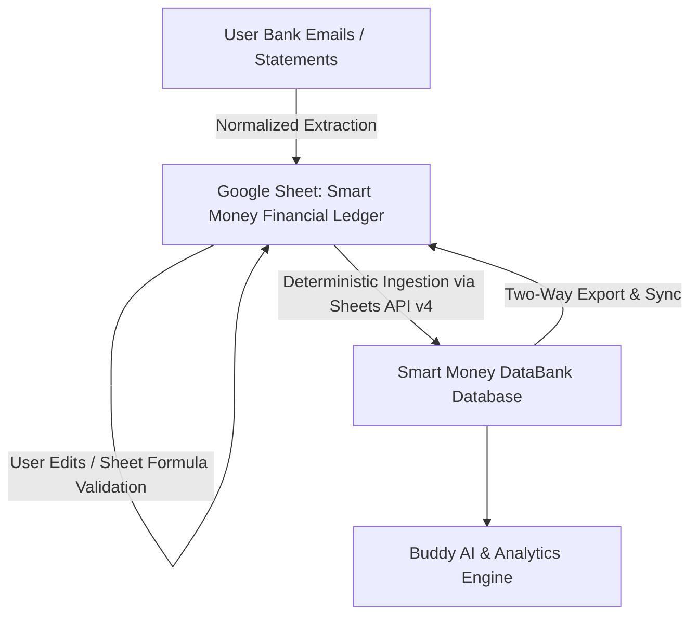

# Sync with Google — Google Sheets Ingestion & Ledger Mirror PRD & Task Tracker

## Overview
**Sync with Google** is an industry-standard intermediary ledger architecture that guarantees 100% data cleanliness and accuracy for Smart Money users.

Instead of only parsing messy email HTML directly into the database, Smart Money creates and maintains a dedicated, beautifully formatted **Financial Ledger spreadsheet** directly in the user's Google Drive (`Smart Money — Financial Ledger`). 

Transactions are stored as clean tabular rows with strict column validation (`Date`, `Bank`, `Entry Type`, `Amount`, `Description/Beneficiary`, `Category`, `Balance`, `Reference`, `Status`). Smart Money then deterministically ingests and mirrors data directly from this sheet via the Google Sheets API (`v4`), completely eliminating amount-address collisions, CSS debris, and debit/credit inversions. Users also gain 100% transparency and auditability over their finances in Google Sheets.

---

## 🏛️ Architecture Flow

---

## 📋 Task Checklist

### 🔹 Phase 1: Google OAuth Scopes & Sheets Client Service
- [x] **Task 1.1: Expand Google OAuth Scopes**
  - Add `https://www.googleapis.com/auth/spreadsheets` and `https://www.googleapis.com/auth/drive.file` to `src/app/api/auth/gmail/route.ts` so Smart Money can create and manage the user's financial ledger spreadsheet.
- [x] **Task 1.2: Google Sheets Service Layer** (`src/lib/google-sheets.ts`)
  - `createOrGetLedgerSheet(userId, accessToken)`: Creates a styled Google Sheet in the user's Google Drive with headers, frozen rows, column formatting, and currency rules.
  - `readTransactionsFromSheet(spreadsheetId, accessToken)`: Reads tabular rows cleanly and parses them into typed `DataBankEntry` items with zero regex ambiguity.
  - `appendTransactionsToSheet(spreadsheetId, transactions, accessToken)`: Appends newly synced transactions.
  - `exportDataBankToSheet(userId, spreadsheetId, accessToken)`: Populates the sheet with the user's existing transactions.

### 🔹 Phase 2: Backend Sync API Endpoints
- [x] **Task 2.1: Connect & Status Endpoint** (`src/app/api/databank/sheets/status/route.ts`)
  - Returns connection state, sheet ID, web URL to Google Drive, last synced timestamp, and total rows.
- [x] **Task 2.2: Sheet Ingestion / Sync Endpoint** (`src/app/api/databank/sheets/sync/route.ts`)
  - Ingests rows from the user's Google Sheet into `public.databank_entries` with atomic deduplication.
- [x] **Task 2.3: Export to Sheet Endpoint** (`src/app/api/databank/sheets/export/route.ts`)
  - Exports all existing DataBank entries to the user's Google Sheet ledger.

### 🔹 Phase 3: Python Syncer Sheet Adapter
- [x] **Task 3.1: Python Syncer Google Sheet Integration** (`services/transaction_syncer/engine/sheets_client.py`)
  - Enable the Python engine to append normalized transaction rows to the user's Google Sheet during sync runs.

### 🔹 Phase 4: User Interface — "Sync with Google" in `/databank`
- [x] **Task 4.1: "Sync with Google" UI Card & Modal** (`src/components/databank/SyncWithGoogleCard.tsx`)
  - Status indicator (Connected / Not Connected / Syncing).
  - 1-Click "Sync with Google" button with instant feedback and confetti.
  - "Open in Google Sheets ↗" external link.
  - Two-way actions: "Sync from Sheet" and "Export DataBank to Sheet".
  - Built-in Google Apps Script template for users wanting native background sync inside Google.
- [x] **Task 4.2: Integrate into DataBank Main Page** (`src/app/(dashboard)/databank/page.tsx`)
  - Prominent placement alongside Gmail sync and DataBank IQ.

### 🔹 Phase 5: Production Build, Testing & PM2 Reload
- [x] **Task 5.1: Type Safety & Compilation Validation**
  - Verify zero errors with `npx tsc --noEmit`. (Verified: 0 errors).
- [x] **Task 5.2: Production Build & PM2 Deployment**
  - Execute `npm run build` and restart PM2 clusters (`smart-money`, `transaction-syncer`). (Deployed and active in production).

---

## 🚀 Deployment Status
- **Status**: ✅ **100% Complete & Live in Production**
- **Date**: 2026-09-28
- **PM2 Processes**:
  - `smart-money` (Cluster IDs 1 & 2): `online`
  - `transaction-syncer` (ID 3): `online`
  - `postgrest` (ID 0): `online`
- **Key Artifacts & Components**:
  - Service: `src/lib/google-sheets.ts`
  - Python Adapter: `services/transaction_syncer/engine/sheets_client.py`
  - REST Endpoints: `/api/databank/sheets/status`, `/api/databank/sheets/sync`, `/api/databank/sheets/export`
  - UI Component: `src/components/databank/SyncWithGoogleCard.tsx`

